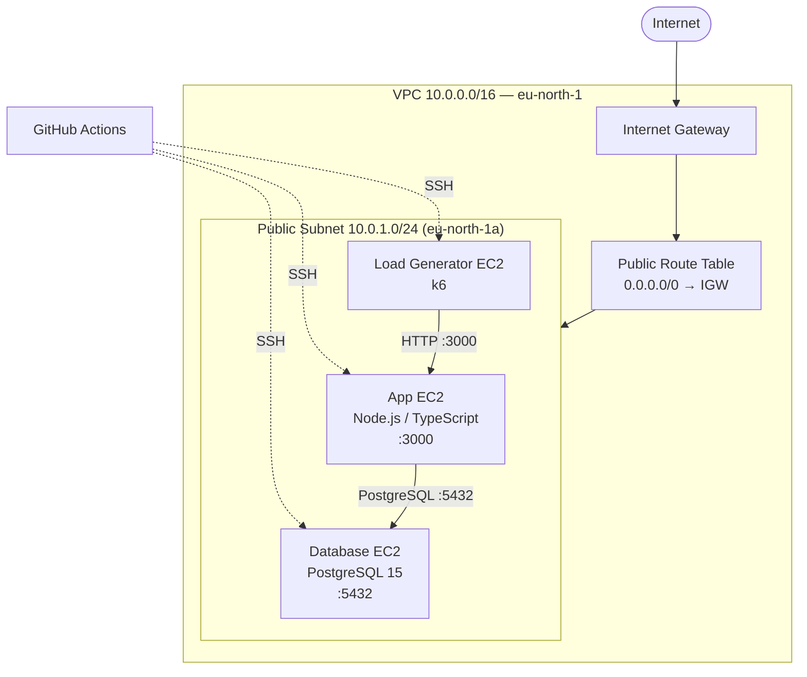

# AWS Migration Lab

A Terraform-based lab that provisions an isolated AWS network and deploys a Node.js/TypeScript
application backed by PostgreSQL to Amazon EC2, with GitHub Actions driving the application and
database setup and a k6 load generator for performance testing.

> All values below are taken directly from the repository (`main.tf`, `variables.tf`, `modules/`,
> `scripts/`, and `.github/workflows/`). The default AWS region is **`eu-north-1`**, the default
> instance type is **`t3.nano`**, and the workload runs on **Amazon Linux 2023**.

---

## Table of Contents

1. [Project Overview](#1-project-overview)
2. [Architecture Overview](#2-architecture-overview)
3. [Technology Stack](#3-technology-stack)
4. [Repository Structure](#4-repository-structure)
5. [Infrastructure Provisioning with Terraform](#5-infrastructure-provisioning-with-terraform)
6. [Application and Database Deployment](#6-application-and-database-deployment)
7. [CI/CD with GitHub Actions](#7-cicd-with-github-actions)
8. [Load Testing with k6](#8-load-testing-with-k6)
9. [Monitoring and Observability](#9-monitoring-and-observability)
10. [Security Considerations](#10-security-considerations)
11. [Cleanup and Cost Management](#11-cleanup-and-cost-management)

---

## 1. Project Overview

The **AWS Migration Lab** demonstrates the full path of moving a small, database-backed web
application from a local/legacy environment onto AWS:

- **Infrastructure provisioning** — a dedicated VPC, public subnet, internet gateway, route
  table, and three EC2 instances created with reusable Terraform modules.
- **Networking** — network isolation, public exposure only where required, and
  security-group-scoped communication between the application, database, and load generator.
- **Database deployment** — a dedicated PostgreSQL EC2 instance, bootstrapped by a `user_data`
  script that installs and initializes PostgreSQL 15.
- **Application deployment** — the Node.js application is cloned to the App EC2 instance and
  configured to connect to PostgreSQL; it is built and run as a background process.
- **Automation** — GitHub Actions workflows connect to each EC2 instance over SSH to perform the
  application setup, database schema creation, and traffic-test file creation.
- **Load testing** — a k6 load generator instance targets the application to exercise its
  endpoints under concurrency.

The application itself lives in a separate repository, `taha203040/migration`, and is cloned onto
the App EC2 instance at deployment time. This repository (`infra_migration`) owns the
infrastructure, the instance bootstrap scripts, and the deployment automation.

---

## 2. Architecture Overview

### Components and responsibilities

| Component | Responsibility |
| --- | --- |
| **Terraform** | Infrastructure as Code. Declares the VPC, subnet, gateway, routing, security groups, and three EC2 instances via a reusable `modules/ec2` module. |
| **VPC** | Network isolation. A dedicated VPC (`10.0.0.0/16`) replaces the AWS default VPC. |
| **Public subnet** | Resource placement. A single public subnet (`10.0.1.0/24`) in `eu-north-1a` with `map_public_ip_on_launch = true`. All three EC2 instances are launched here. |
| **Internet Gateway & route table** | Internet connectivity. An internet gateway is attached to the VPC, and a public route table routes `0.0.0.0/0` to it. |
| **Security groups** | Controlled communication. `app`, `database`, and `load-generator` security groups restrict traffic between instances. |
| **App EC2** | Hosts the Node.js/TypeScript application (Express API on port 3000). |
| **Database EC2** | Hosts PostgreSQL 15 on port 5432. |
| **Load Generator EC2** | Runs k6 load tests against the application. |
| **GitHub Actions** | Automates application setup, database initialization, and traffic-test file creation over SSH. |
| **CloudWatch** | **Not provisioned by this configuration.** No CloudWatch resources are declared in Terraform. |
| **Grafana** | **Not provisioned by this configuration.** No Grafana resources are declared in Terraform. |

> **Note:** The repository contains no CloudWatch, Grafana, or IAM resources. Where the task
> brief mentions those components "where configured", they are documented as **not configured**
> here rather than presented as implemented features.

### Request and data flow

1. The **App EC2** instance accepts HTTP traffic (application listens on port `3000`).
2. The App EC2 connects to **PostgreSQL** on the **Database EC2** at port `5432`, authorized by
   the `app` security group.
3. The **Load Generator EC2** sends HTTP requests from k6 to the App EC2 and observes the
   responses.
4. **GitHub Actions** connects to each EC2 instance over **SSH** to run setup tasks.
5. Outbound traffic from all instances exits through the **internet gateway** and public route
   table.

### Architecture diagram



> The security group for App EC2 exposes port `4000` in Terraform, while the application is
> configured to listen on port `3000` (`.env`). See
> [Known considerations](#10-security-considerations) for this mismatch.

---

## 3. Technology Stack

| Layer | Technology | Notes |
| --- | --- | --- |
| Cloud provider | AWS | Region `eu-north-1` (Stockholm) by default. |
| Infrastructure as Code | Terraform `>= 1.6.0` | AWS provider `~> 5.0`. |
| Compute | Amazon EC2 | Three `t3.nano` instances (default). |
| Operating system | Amazon Linux 2023 | Assumed by the `dnf`-based bootstrap scripts; AMI `ami-08e7e754b2c895da7` is region-specific. |
| Networking | Amazon VPC | Dedicated VPC, public subnet, internet gateway, route table. |
| Application runtime | Node.js + TypeScript | Express API; build via `tsc`, run via `node dist/server.js`. |
| Database | PostgreSQL 15 | `postgresql15-server` / `postgresql15` packages. |
| Automation | GitHub Actions | `appleboy/ssh-action@v1.2.2` over SSH. |
| Access | SSH (EC2 key pair) | `EC2_USER` + `EC2_SSH_KEY` secrets. |
| Load testing | k6 | Installed from the official RPM repository. |
| Object storage / DB driver | `pg`, `bcryptjs`, `dotenv`, `express` | Application dependencies (in the `migration` repo). |

---

## 4. Repository Structure

```
migration-lab/
├── .github/
│   └── workflows/
│       ├── setup-app.yml          # Clones, configures, builds and runs the app on App EC2
│       ├── setup-db.yml           # Configures PostgreSQL and creates the schema
│       ├── setup-traffic.yml      # Creates the k6 traffic test file on the load generator
│       ├── MigrationRunner.yml    # Placeholder (comment only)
│       ├── MigrationRunnerDB.yml  # Placeholder (comment only)
│       ├── BackfillRunner.yml     # Placeholder (comment only)
│       └── TrafficRunner.yml      # Placeholder (comment only)
├── modules/
│   └── ec2/
│       ├── main.tf                # Single aws_instance resource
│       ├── variables.tf           # Module inputs (name, ami_id, subnet_id, user_data, ...)
│       └── outputs.tf             # instance_id, public/private IP, public DNS
├── scripts/
│   ├── app.sh                     # App EC2 user_data: update, install Node.js + git
│   ├── db.sh                      # DB EC2 user_data: swap, PostgreSQL 15, init, config
│   └── k6.sh                      # Load-gen user_data: update, install k6
├── main.tf                        # VPC, subnet, IGW, route table, SGs, module calls
├── variables.tf                   # Root variables (region, type, AMI, CIDRs, key)
├── outputs.tf                     # Public/private IPs for all three instances
├── versions.tf                    # Terraform/provider version constraints
├── setup.sh                       # Reads `terraform output` and writes GitHub Secrets
├── terraform.tfvars.example       # Example variable values
└── .gitignore                     # Excludes state, tfvars, .env, PEM keys, etc.
```

### File responsibilities

- **`main.tf`** — Declares the dedicated VPC (`10.0.0.0/16`), the public subnet
  (`10.0.1.0/24`), internet gateway, public route table and association, the three security
  groups, and instantiates `modules/ec2` three times (`app`, `database`, `load_generator`) with the
  matching `user_data` script. Two additional modules (`new_app`, `backfill`) are present but
  **commented out** and therefore inactive.
- **`variables.tf`** — Defaults: `aws_region = "eu-north-1"`, `instance_type = "t3.nano"`,
  `project_name = "migration-lab"`, `ami_id = "ami-08e7e754b2c895da7"`, `key_name =
  "migration_key"`, `vpc_cidr = "10.0.0.0/16"`, `public_subnet_cidr = "10.0.1.0/24"`.
- **`outputs.tf`** — Exposes `app_public_ip`, `app_private_ip`, `database_private_ip`,
  `database_public_ip`, `load_generator_public_ip`, `load_generator_private_ip`.
- **`modules/ec2/`** — A reusable single-instance module: `aws_instance` with the given AMI, type,
  subnet, security groups, key name, a **10 GB `gp3`** root volume, `associate_public_ip_address =
  true`, and an optional `user_data` script.
- **`scripts/app.sh`** — App EC2 bootstrap: `dnf update`, install `nodejs`, install `git`,
  verify versions.
- **`scripts/db.sh`** — Database EC2 bootstrap: configure 1 GB swap, install
  `postgresql15-server`/`postgresql15`, initialize the cluster, set `listen_addresses = '*'`, set
  `port = 5432`, add a `10.0.0.0/16` `scram-sha-256` rule to `pg_hba.conf`, enable/start the
  service, wait for readiness, and verify.
- **`scripts/k6.sh`** — Load-gen bootstrap: `dnf update`, install `curl`/`tar`, add the k6 RPM
  repository, install `k6`, verify.
- **`setup.sh`** — Reads `terraform output` values and pushes them into GitHub repository secrets
  via the `gh` CLI; also prompts for the database password and the SSH key path.
- **`terraform.tfvars.example`** — Example values (note: it uses `t3.micro`, while the variable
  default is `t3.nano`).
- **`.gitignore`** — Excludes `.terraform/`, `*.tfstate*`, `*.tfvars`, `.env`, `*.pem`, `*.key`,
  and editor/OS files.

Generated or sensitive files (not committed): `.terraform/`, `.terraform.lock.hcl` (may be
committed intentionally), `terraform.tfstate`, `terraform.tfstate.backup`, `*.tfvars`, `.env`,
`*.pem`, `*.key`.

---

## 5. Infrastructure Provisioning with Terraform

### Prerequisites

- Terraform `>= 1.6.0` and the AWS provider `~> 5.0`.
- AWS CLI configured with credentials that can create VPC, EC2, and security-group resources.
- An existing EC2 key pair in the target region; set its name via `key_name` (default
  `migration_key`).
- The AMI ID (`ami_id`) must exist in the configured region; the default targets
  `eu-north-1`.

### AWS CLI configuration and authentication

```bash
aws configure
# or use a named profile:
export AWS_PROFILE=my-profile
```

### Initialize, validate, and plan

```bash
terraform init
terraform fmt -check
terraform validate
terraform plan
```

### Deploy

```bash
terraform apply
```

### Retrieve outputs

```bash
terraform output
terraform output -raw app_public_ip
terraform output -raw database_private_ip
```

These outputs are what `setup.sh` and the GitHub Actions secrets rely on.

### Update infrastructure safely

```bash
terraform plan     # review the diff first
terraform apply    # apply only the reviewed changes
```

### About `terraform.tfstate`

`terraform.tfstate` is Terraform's record of provisioned resources. It can contain resource
identifiers and attribute values that are sensitive (for example, private IPs and security-group
identifiers). It **must not be committed** to source control — `.gitignore` already excludes
`*.tfstate` and `*.tfstate.*`. For team use, configure a remote, encrypted, locked backend (for
example S3 with DynamoDB state locking) instead of the local state file.

---

## 6. Application and Database Deployment

The deployment follows this sequence:

1. **Provision AWS infrastructure** — `terraform apply` creates the VPC, subnet, gateway,
   routing, security groups, and the three EC2 instances. Each instance runs its `user_data`
   script on first boot.
2. **Initialize the database EC2 instance** — `scripts/db.sh` configures swap and installs
   PostgreSQL 15.
3. **Install and configure PostgreSQL** — `db.sh` initializes the cluster, sets
   `listen_addresses = '*'`, sets `port = 5432`, and enables/starts the service.
4. **Configure database authentication and networking** — `db.sh` appends a
   `host all all 10.0.0.0/16 scram-sha-256` rule to `pg_hba.conf`; Terraform restricts port 5432
   to the App security group.
5. **Create the application database and schema** — the **`setup-db`** workflow connects over
   SSH, sets the `postgres` password from `DB_PASSWORD`, creates the `migration_lab` database, and
   creates the `users` and `posts` tables plus `idx_posts_user_id` (idempotently, `IF NOT
   EXISTS`).
6. **Deploy the Node.js application** — the **`setup-app`** workflow connects over SSH, clones or
   updates `taha203040/migration` at `~/migration`, installs global `typescript`/`tsx`, runs
   `npm ci`, installs the TypeScript type packages, runs the build, and restarts the process.
7. **Configure the application to connect to PostgreSQL** — `setup-app` writes `~/migration/.env`
   with `PORT=3000` and `DATABASE_URL` built from `DB_PASSWORD` and `DB_PRV_IP`.
8. **Verify application health and database connectivity** — `setup-app` waits and confirms the
   process is alive; the application's `/health` endpoint reports status; `setup-db` verifies the
   tables.

### Environment variables (App EC2 `~/migration/.env`)

| Variable | Purpose | Source |
| --- | --- | --- |
| `PORT` | HTTP port the API listens on (`3000`) | Hardcoded in the workflow |
| `DATABASE_URL` | PostgreSQL connection string | `DB_PASSWORD`, `DB_PRV_IP` secrets |

The database is expected to be reachable at `postgresql://postgres:<password>@<DB_PRV_IP>:5432/migration_lab`.

---

## 7. CI/CD with GitHub Actions

All three workflows are **manually triggered** (`workflow_dispatch`) and use
`appleboy/ssh-action@v1.2.2` to run commands on an EC2 instance over SSH. The SSH user and key
are taken from the `EC2_USER` and `EC2_SSH_KEY` secrets.

### `setup-app.yml`

- **Purpose:** Clone/update, build, and (re)start the Node.js application.
- **Trigger:** Manual (`workflow_dispatch`).
- **Target:** App EC2 (`APP_EC2_HOST`).
- **Tasks:** Clone or `git pull` `taha203040/migration` into `~/migration`; install global
  `typescript` and `tsx`; write `.env` (`PORT=3000`, `DATABASE_URL`); `npm ci`; install
  `typescript tsx @types/node @types/express @types/pg` as dev dependencies; `npm run build`;
  stop any previous process from `~/migration.pid`; start `npm start` with `nohup`; verify the
  process is alive.
- **Secrets:** `APP_EC2_HOST`, `EC2_USER`, `EC2_SSH_KEY`, `DB_PASSWORD`, `DB_PRV_IP`.

### `setup-db.yml`

- **Purpose:** Configure PostgreSQL authentication and create the application schema.
- **Trigger:** Manual.
- **Target:** Database EC2 (`DB_EC2_HOST`).
- **Tasks:** Validate that `DB_PASSWORD`/`DB_PRV_IP` are present; confirm the `postgresql`
  service is active; set the `postgres` role password; export `PGPASSWORD`; verify a TCP
  connection to `DB_PRV_IP`; create the `migration_lab` database if missing; create `users`,
  `posts`, and `idx_posts_user_id` if missing; list tables.
- **Secrets:** `DB_EC2_HOST`, `EC2_USER`, `EC2_SSH_KEY`, `DB_PASSWORD`, `DB_PRV_IP`.

### `setup-traffic.yml`

- **Purpose:** Create the k6 traffic-generation script file.
- **Trigger:** Manual.
- **Target:** Load Generator EC2 (`K6_EC2_HOST`).
- **Tasks:** Verify k6 is installed; create `~/migration-load-test/traffic.ts` targeting the
  application at `http://<EC_APP_PRV>:3000` (5 VUs, 30s duration, expects HTTP 200); confirm the
  file was created.
- **Secrets:** `K6_EC2_HOST`, `EC2_USER`, `EC2_SSH_KEY`, `EC_APP_PRV`.

### Required repository secrets

| Secret | Used by | Purpose |
| --- | --- | --- |
| `APP_EC2_HOST` | setup-app | App EC2 public IP (SSH target). |
| `DB_EC2_HOST` | setup-db | Database EC2 public IP (SSH target). |
| `EC_APP_PRV` | setup-traffic | App EC2 private IP (k6 target). |
| `DB_PRV_IP` | setup-app, setup-db | Database EC2 private IP (connection target). |
| `K6_EC2_HOST` | setup-traffic | Load generator public IP (SSH target). |
| `EC2_USER` | all | SSH username (`ec2-user`). |
| `EC2_SSH_KEY` | all | SSH private key. |
| `DB_PASSWORD` | setup-app, setup-db | PostgreSQL password. |

`setup.sh` populates most of these automatically from `terraform output` (and prompts for the
database password and SSH key path). Secret **values** are never written into this repository.

### How SSH-based deployment works

GitHub Actions does not use an IAM role or an EC2 instance profile for deployment. Instead, each
workflow's `ssh-action` step opens a TCP connection to the instance's **public IP** (`*_EC2_HOST`)
on port **22** with the `EC2_USER` username and the `EC2_SSH_KEY` private key. The commands in the
`script` block execute on the instance. Port 22 is open to `0.0.0.0/0` in all three security
groups (see [Security Considerations](#10-security-considerations)).

---

## 8. Load Testing with k6

- **Load Generator EC2** is provisioned like the other instances and runs `scripts/k6.sh` on first
  boot, which installs `k6` from the official RPM repository.
- **Traffic file:** the `setup-traffic` workflow writes `~/migration-load-test/traffic.ts`. The
  test targets the application at `http://<EC_APP_PRV>:3000`, runs **5 VUs for 30 seconds**, and
  checks that responses return **HTTP 200**.
- **Execute the load test** (manually, on the Load Generator EC2):

```bash
cd ~/migration-load-test
k6 run traffic.ts
```

- **Metrics to observe:**
  - `http_req_duration` — request latency (and its `p(95)` / `p(99)` percentiles).
  - `http_reqs` — throughput (requests and requests/sec).
  - `http_req_failed` — error rate.
  - `checks` — pass/fail rate of the `status is 200` check.
  - `vus` / `vus_max` — concurrent virtual users.

> **Note:** The traffic test targets port `3000`, while the App security group in Terraform
> allows inbound port `4000`. See the mismatch note under
> [Security Considerations](#10-security-considerations).

---

## 9. Monitoring and Observability

This repository does **not** configure CloudWatch (log groups, metrics, alarms) or Grafana in
Terraform. The observability available is the native output of the components themselves:

| Source | What is available | Where |
| --- | --- | --- |
| **CloudWatch** | Not configured — no AWS infrastructure metrics/log shipping is declared. | — |
| **Instance bootstrap logs** | `app.sh`, `db.sh`, `k6.sh` output is teed to `/var/log/app-init.log`, `/var/log/db-init.log`, `/var/log/k6-init.log`. | EC2 instances |
| **Application-level logs** | `npm start` stdout/stderr redirected to `~/migration.log`; the API exposes `/health`. | App EC2 |
| **PostgreSQL** | Service state and logs via `systemctl status postgresql` / `journalctl -u postgresql`. | Database EC2 |
| **k6 results** | Console summary (latency, throughput, error rate, checks) when the test is run. | Load Generator EC2 |
| **Grafana** | Not configured — no dashboards or data sources are provisioned. | — |

No component in this repository claims to monitor something that the implementation does not
support. CloudWatch and Grafana would need to be added explicitly.

---

## 10. Security Considerations

### Implemented controls

- **SSH key authentication** — instances are accessed with an EC2 key pair (`key_name`); no
  password-based SSH is configured.
- **Security-group-scoped communication** — the database security group allows port `5432` only
  from the App security group; the App security group allows `4000` and `22`; the load-generator
  security group allows `22`.
- **Network placement** — all resources live in a dedicated VPC rather than the AWS default VPC.
- **PostgreSQL authentication** — `db.sh` adds a `scram-sha-256` rule for `10.0.0.0/16`, and
  `setup-db` sets the `postgres` role password from `DB_PASSWORD`.
- **GitHub Secrets** — sensitive values (`EC2_SSH_KEY`, `DB_PASSWORD`, host IPs) are stored as
  repository secrets and referenced via `${{ secrets.* }}`; no credentials are hardcoded in
  workflows.
- **State protection** — `.gitignore` excludes `*.tfstate*`, `*.tfvars`, `.env`, `*.pem`, and
  `*.key`.

### Recommended improvements (not implemented)

- **Restrict SSH sources** — port `22` is open to `0.0.0.0/0` in all three security groups;
  restrict it to a known CIDR or use AWS Systems Manager Session Manager instead of public SSH.
- **Align the application port** — the App security group allows `4000`, but the application
  listens on `3000` and the k6 test targets `3000`. Inbound application traffic to the actual
  listener port is currently not allowed by the security group.
- **Least-privilege IAM** — no IAM instance profile or role is attached; consider one if the
  instances later need AWS API access, and avoid long-lived access keys.
- **Remote Terraform state** — move state to an encrypted, versioned backend with locking.
- **Secret rotation** — rotate `EC2_SSH_KEY` and `DB_PASSWORD` periodically.
- **Database network exposure** — `listen_addresses = '*'` is safe only because of the security
  group; keeping the rule `scram-sha-256` for the VPC CIDR is appropriate.

---

## 11. Cleanup and Cost Management

Tear down all provisioned infrastructure with:

```bash
terraform destroy
```

After destroying, confirm that no billable resources remain:

- **EBS volumes** — root volumes are deleted with the instances, but verify none were orphaned.
- **Elastic IPs** — public IPs are dynamic (no `aws_eip` is declared), so nothing persists, but
  check for any manually allocated EIPs.
- **Snapshots / AMIs** — verify no leftover EBS snapshots or custom AMIs.
- **EC2 key pair** — `migration_key` (or your `key_name`) is not managed by Terraform; remove it
  manually if it is no longer needed.
- **k6 traffic files** — created under `~/migration-load-test` on the load generator; removed
  with the instance.

Always review the `terraform destroy` plan before confirming.
